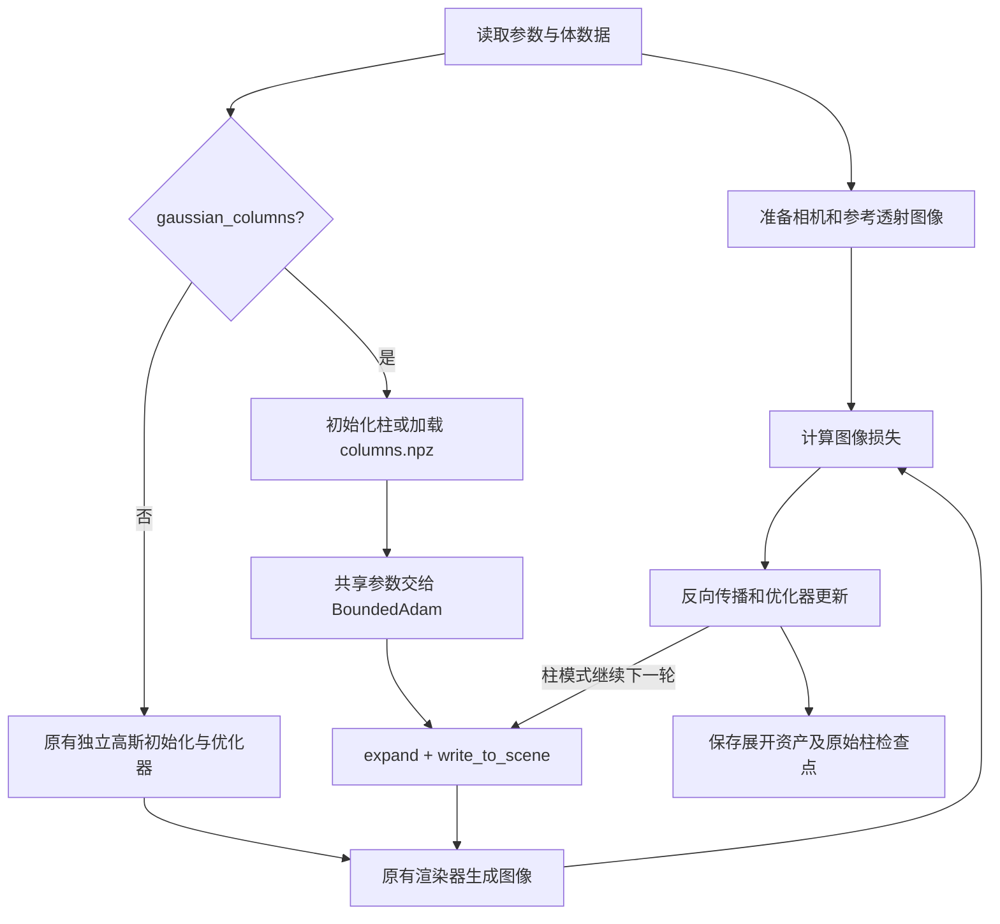

> Current setup: generate or load column parameters, create the scene, read scene parameters into a new optimizer, set bounds and learning rates, then restore checkpoint Adam state through load_columns(..., opt=opt). Column generation and checkpoint loading do not create an optimizer.

# Gaussian 柱模式如何接入原训练流程

本文对应 `gfields/train.py` 和 `gfields/training/regression.py` 中新增的柱模式分支。现在仍从 `python -m gfields.train` 启动训练；开启 `--use_columns_representation` 后，优化器保存共享的 XY 参数，渲染前再展开成现有高斯。

这里共享的是 **XY footprint，轴向是 Z**。本次接入的是 Gaussian 阶段；不是新的 Gabor 柱渲染器，也还没有实现“一根柱只进入 BVH 一次”。

## 1. 先看整体流程



最关键的区别是：**优化器里保存柱参数，场景里使用展开后的高斯参数。** 场景里的展开数组不是另一套可独立学习的参数。

## 2. 参数入口：`regression.py`

新增入口集中在 [gfields/training/regression.py](gfields/training/regression.py) 的 `setup()`，可搜索 `--use_columns_representation`。

| 参数 | 默认值 | 含义 |
|---|---:|---|
| `--use_columns_representation` | 关闭 | 开启共享 XY 的 Gaussian 柱模式 |
| `--column_count` | 64 | 所有初始化 slab 合计的柱数，不是每个 slab 的柱数 |
| `--primitives_per_column` | 4 | 每根柱内部的轴向高斯数量 |
| `--column_slab_depth` | 0 | 初始化 slab 的深度，单位是输入数组的 Z 体素；0 表示整个占据 Z 区间 |
| `--column_lr` | 0.01 | 柱参数基础学习率，继续乘现有中心、尺度、旋转、权重学习率系数 |

开启柱模式后，`setup()` 会执行：

```python
args.skip_gabor_optim = True
args.gauss_count = args.column_count * args.primitives_per_column
args.densify_until = 0
args.relocate_until = 0
```

因此 64 根柱、每柱 4 个分量，当前场景里会得到 256 个展开高斯。`gauss_count` 在此模式下由柱参数计算，不再单独决定模型规模。

`setup()` 还会拒绝与柱模式冲突的组合：跳过 Gaussian 阶段、加载 Gabor 检查点，以及独立基元的后处理剪枝/extent 调整。给了不存在的柱检查点路径时会报错，避免悄悄改成从头训练。

## 3. 初始化或加载：`train.py`

在 Gaussian 阶段之前，新增以下分支：

```python
if args.use_columns_representation:
    if args.from_gaussian_checkpoint:
        gaussian_columns, column_start_iteration = load_columns(Path(args.from_gaussian_checkpoint), args)
    else:
        gaussian_columns = generate_random_columns(
            args.column_count, args.primitives_per_column, args.init_opacity, args.init_scale, args.init_albedo,
            volume=gauss_ref_volume, volume_config=volume_config,
            column_slab_depth=args.column_slab_depth, seed_offset=args.seed_offset
        )
    scene_dict = create_scene_dict_from_primitives(args.max_depth, GAUSS_LVL, use_columns_representation=args.use_columns_representation, gaussian_columns=gaussian_columns)
```

- `generate_random_columns()` 创建共享横向参数和独立轴向参数，并创建优化器。
- `load_columns()` 恢复原始共享参数、Adam 状态、尺度约束、固定 albedo 和已完成迭代数。
- `create_scene_dict_from_primitives(..., use_columns_representation=True, gaussian_columns=gaussian_columns)` 生成原有场景创建函数需要的 `centers/scales/quaternions/opacities/omega/albedo`。

`create_scene_dict_from_primitives(..., use_columns_representation=True, gaussian_columns=gaussian_columns)` 用于搭建场景所需的初始数值；之后调用可微的 `write_optimizer_params_to_scene()`，才把渲染参数接回共享优化器中的变量。初始化、展开和检查点的内部实现位于 [gfields/training/columns.py](gfields/training/columns.py)。

不开启柱模式时，原来的 `generate_random_kernels()` 和独立高斯检查点分支继续使用。

## 4. 优化器只优化原始柱参数

原有路径先从场景读出高斯数组，放进优化器。柱模式改为直接使用初始化或检查点建立的优化器：

```python
if gaussian_columns is not None:
    opt = gfields.optimizers.BoundedAdam(noise_init=0.0)
    write_scene_params_to_optimizer(scene_params, opt, level=GAUSS_LVL, args=args, gaussian_columns=gaussian_columns)
    lr_dict = create_lr_dict(args, args.column_lr, level=GAUSS_LVL)
    configure_optimizer(opt, args, lr_dict, level=GAUSS_LVL, gaussian_columns=gaussian_columns)
    if args.from_gaussian_checkpoint:
        gaussian_columns, column_start_iteration = load_columns(Path(args.from_gaussian_checkpoint), args, opt=opt)
    write_optimizer_params_to_scene(opt, scene_params, level=GAUSS_LVL, gaussian_columns=gaussian_columns)
```

例如同一根柱的 4 个展开高斯，共享同一个 `column_center_x`。反向传播时，4 个高斯对横向中心的梯度会累加回这一个变量。优化之后，这 4 个高斯仍然共享同一中心。

柱优化器复用现有 `BoundedAdam`，但把旧的基元中心噪声关闭：`noise_init=0.0`。旧噪声逻辑按 `centers_0/scales_0/quaternions_0` 等独立高斯键名工作，不能直接套用到柱参数。

尺度下界按各轴世界体素间距的半值设置；权重保持正数。这用于避免尺度压缩到远小于一个体素，形成投影看似正确、密度却有尖峰的解。

## 5. 每轮渲染和梯度更新

渲染前，把当前柱参数重新展开、写入场景：

```python
with timer.track('forward'):
    if gaussian_columns is not None:
        write_optimizer_params_to_scene(opt, scene_params, level=GAUSS_LVL, gaussian_columns=gaussian_columns)
    image, img_loss, l1, ssim, img_mse = _batched_render_loss(
        scene, scene_params, ref_image, opt_cam_batches,
        spp=args.opt_spp, spp_grad=args.grad_spp, seed=it + args.seed_offset,
        l1_weight=0.75, ssim_weight=0.25,
    )
```

`_batched_render_loss()`、核函数、透射积分和当前渲染器继续复用。主要图像损失仍然是 `0.75 × L1 + 0.25 × SSIM loss`。

**这里的真实数据实验仍是图像监督训练**：体数据先生成参考透射图像，模型拟合这些图像。导出的体素密度切片用于检查结果，没有被额外加入体素 MSE 监督；SVD 结果也不参与此次优化。

损失中的权重与尺度正则项改用柱优化器的键名：

```python
if gaussian_columns is not None:
    opacity_penalty = dr.sum(dr.abs(opt['primitive_opacity'])) * args.lambda_opacity
    scale_penalty = (dr.sum(opt['column_scale_x']) + dr.sum(opt['column_scale_y']) + dr.sum(opt['primitive_scale_z'])) * args.lambda_scale
```

共享横向尺度在这个正则里按柱计数一次，轴向尺度按分量计数；不是把展开后重复的尺度再累加。默认这两个正则系数均为 0。原来的频率正则函数仍然被调用，但 Gaussian 第 0 层没有 Gabor 频率项，结果为 0。

反向传播和更新继续使用原有函数，更新后再次同步场景：

```python
dr.backward(loss)
opt.step()
if gaussian_columns is not None:
    write_optimizer_params_to_scene(opt, scene_params, level=GAUSS_LVL, gaussian_columns=gaussian_columns)
else:
    write_optimizer_params_to_scene(opt, scene_params, level=GAUSS_LVL)
```

上面片段省略了计时、回调等外围代码。它说明共享关系在参数源头保持，不是每次更新后再把独立高斯人为平均。

## 6. 学习率调度和恢复训练

继续复用原有 `LRScheduler`，柱模式使用 `create_lr_dict()` 和 `args.column_lr`，不使用默认值较大的 `global_lr_gaussian`。

```python
if gaussian_columns is not None:
    lr_scheduler.current_step = column_start_iteration
```

循环从检查点的 `column_start_iteration` 开始。柱模式中，`--iterations_gaussian` 是**累计目标步数**：检查点完成 200 步，设为 201 就再训练 1 步，不是再训练 201 步。

恢复时应保持体数据、相机、图像分辨率和损失配置一致；代码不会自动把检查点原来的所有命令行配置覆盖回来。改变累计目标步数，也会改变按总步数计算的学习率曲线。

## 7. 为什么关闭独立基元操作

旧的重定位、增密、剪枝以一个独立高斯为操作单位。如果直接拿来删除或移动柱中的某个展开分量，原始柱参数与场景布局就可能不一致。

目前的处理是：

- `setup()` 把 `densify_until`、`relocate_until` 设置为 0。
- 重定位执行条件额外要求 `gaussian_columns is None`。
- Gaussian 阶段结束时，柱模式跳过原来的 `prune()`。
- 跳过 Gabor 阶段，拒绝独立基元后处理。

这次没有新增“按柱拆分、按柱删除、按柱增密”算法。默认独立高斯/Gabor 路径保留原来的控制逻辑。

## 8. 保存、指标和图片

每次周期检查点仍保存展开资产，同时另存原始柱参数：

```python
save_model(args.output, scene, level=GAUSS_LVL)
if gaussian_columns is not None:
    save_columns(gaussian_columns, args.output, iteration=completed_iterations)
```

最终保存时还会调用 `save_column_slices()`，生成目标密度、重建密度和固定显示范围误差图。

| 输出 | 用途 |
|---|---|
| `optimized_asset_pyr0/data/` | 当前渲染器可读取的展开高斯资产 |
| `optimized_asset_pyr0/npy_data/columns.npz` | 恢复共享训练关系的原始柱参数及 Adam 状态 |
| `optimized_asset_pyr0/npy_data/column_metadata.json` | 参数规模、尺度约束、迭代数等 |
| `column_training_metrics.csv` | 训练循环日志；使用柱专用轻量回调 |
| `column_render_metrics.json` | 初始/最终图像指标，使用相同渲染 SPP 与默认 seed 0 |
| `column_slices/` | 密度切片 PNG、误差图和密度 PSNR |

柱模式没有使用依赖独立参数名的旧直方图回调，新增 `ColumnMetricsCallback` 直接写 CSV。密度图用 Pillow 输出。

注意指标名称：训练 CSV 中 `SSIM` 是现有的 **SSIM loss，越低越好**；`column_render_metrics.json` 中 `ssim` 是 `1 - SSIM loss`，越高越好。渲染 PSNR 衡量透射图像，密度 PSNR 衡量体素位置上的解析密度，两者不能互相替代。

## 9. 从哪里开始读、怎样运行

建议按以下顺序阅读：

1. `regression.py` 搜索 `--use_columns_representation`：看模式开关和参数。
2. `train.py` 搜索 `gaussian_columns = None`：看初始化与检查点分支。
3. `train.py` 搜索 `opt = gaussian_columns.column_optimizer`：看优化变量的来源。
4. `train.py` 搜索 `write_to_scene`：看共享参数与场景之间的连接。
5. `columns.py` 看 `generate_random_columns/write_scene_params_to_optimizer/configure_optimizer/save_columns/load_columns`。

先准备这次使用的真实小体数据：

```powershell
.\.venv\Scripts\python.exe -m gfields.tests.test_column_training --prepare-real-data
```

最小模式示例（其余训练配置使用默认值，正式小实验的完整命令见根 [README.md](README.md)）：

```powershell
.\.venv\Scripts\python.exe -m gfields.train --volume_grid results/gaussian_column_training_results/ls_native30_crop64_cube.npy --output results/column_demo --opacity_scale 1 --use_columns_representation --column_count 64 --primitives_per_column 4 --column_slab_depth 8 --column_lr 0.003 --gauss_target_level 0 --gabor_target_level 0 --iterations_gaussian 200 --cam_count 16 --cam_res_x 32 --cam_res_y 32 --ref_spp 64 --ref_kernel_spp 16
```

原生柱 BVH 的实现不在本文这些新增训练分支中。当前每轮 `write_optimizer_params_to_scene()` 仍把柱展开成普通高斯，随后使用现有 `ellipsoidsmesh` 求交路径。
